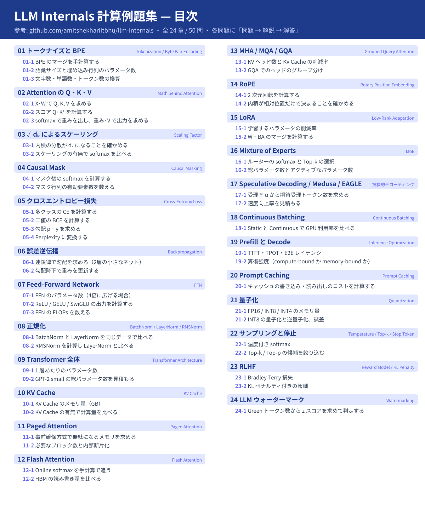

# LLM Internals 計算例題集 — 目次

[amitshekhariitbhu/llm-internals](https://github.com/amitshekhariitbhu/llm-internals) の内容をもとにした計算問題です。
各問題は 1 枚の SVG（`問題 → 解説 → 解答`）にまとめます。

凡例: ⬜ 未作成 / ✅ 作成済み

全 24 章、50 問



## 第1章 トークナイズと BPE  <sub>Tokenization / Byte Pair Encoding</sub>

| No. | 例題 | ファイル | 状態 |
|---|---|---|---|
| 01-1 | BPE のマージを手計算する | [`svg/01_1.svg`](svg/01_1.svg) | ✅ |
| 01-2 | 語彙サイズと埋め込み行列のパラメータ数 | [`svg/01_2.svg`](svg/01_2.svg) | ✅ |
| 01-3 | 文字数・単語数・トークン数の換算 | [`svg/01_3.svg`](svg/01_3.svg) | ✅ |

## 第2章 Attention の Q・K・V  <sub>Math behind Attention</sub>

| No. | 例題 | ファイル | 状態 |
|---|---|---|---|
| 02-1 | X·W で Q, K, V を求める | [`svg/02_1.svg`](svg/02_1.svg) | ✅ |
| 02-2 | スコア Q·Kᵀ を計算する | [`svg/02_2.svg`](svg/02_2.svg) | ✅ |
| 02-3 | softmax で重みを出し、重み·V で出力を求める | [`svg/02_3.svg`](svg/02_3.svg) | ✅ |

## 第3章 √dₖ によるスケーリング  <sub>Scaling Factor</sub>

| No. | 例題 | ファイル | 状態 |
|---|---|---|---|
| 03-1 | 内積の分散が dₖ になることを確かめる | [`svg/03_1.svg`](svg/03_1.svg) | ✅ |
| 03-2 | スケーリングの有無で softmax を比べる | [`svg/03_2.svg`](svg/03_2.svg) | ✅ |

## 第4章 Causal Mask  <sub>Causal Masking</sub>

| No. | 例題 | ファイル | 状態 |
|---|---|---|---|
| 04-1 | マスク後の softmax を計算する | [`svg/04_1.svg`](svg/04_1.svg) | ✅ |
| 04-2 | マスク行列の有効要素数を数える | [`svg/04_2.svg`](svg/04_2.svg) | ✅ |

## 第5章 クロスエントロピー損失  <sub>Cross-Entropy Loss</sub>

| No. | 例題 | ファイル | 状態 |
|---|---|---|---|
| 05-1 | 多クラスの CE を計算する | [`svg/05_1.svg`](svg/05_1.svg) | ✅ |
| 05-2 | 二値の BCE を計算する | [`svg/05_2.svg`](svg/05_2.svg) | ✅ |
| 05-3 | 勾配 p − y を求める | [`svg/05_3.svg`](svg/05_3.svg) | ✅ |
| 05-4 | Perplexity に変換する | [`svg/05_4.svg`](svg/05_4.svg) | ✅ |

## 第6章 誤差逆伝播  <sub>Backpropagation</sub>

| No. | 例題 | ファイル | 状態 |
|---|---|---|---|
| 06-1 | 連鎖律で勾配を求める（2層の小さなネット） | [`svg/06_1.svg`](svg/06_1.svg) | ✅ |
| 06-2 | 勾配降下で重みを更新する | [`svg/06_2.svg`](svg/06_2.svg) | ✅ |

## 第7章 Feed-Forward Network  <sub>FFN</sub>

| No. | 例題 | ファイル | 状態 |
|---|---|---|---|
| 07-1 | FFN のパラメータ数（4倍に広げる場合） | `svg/07_1.svg` | ⬜ |
| 07-2 | ReLU / GELU / SwiGLU の出力を計算する | `svg/07_2.svg` | ⬜ |
| 07-3 | FFN の FLOPs を数える | `svg/07_3.svg` | ⬜ |

## 第8章 正規化  <sub>BatchNorm / LayerNorm / RMSNorm</sub>

| No. | 例題 | ファイル | 状態 |
|---|---|---|---|
| 08-1 | BatchNorm と LayerNorm を同じデータで比べる | `svg/08_1.svg` | ⬜ |
| 08-2 | RMSNorm を計算し LayerNorm と比べる | `svg/08_2.svg` | ⬜ |

## 第9章 Transformer 全体  <sub>Transformer Architecture</sub>

| No. | 例題 | ファイル | 状態 |
|---|---|---|---|
| 09-1 | 1 層あたりのパラメータ数 | `svg/09_1.svg` | ⬜ |
| 09-2 | GPT-2 small の総パラメータ数を見積もる | `svg/09_2.svg` | ⬜ |

## 第10章 KV Cache  <sub>KV Cache</sub>

| No. | 例題 | ファイル | 状態 |
|---|---|---|---|
| 10-1 | KV Cache のメモリ量（GB） | `svg/10_1.svg` | ⬜ |
| 10-2 | KV Cache の有無で計算量を比べる | `svg/10_2.svg` | ⬜ |

## 第11章 Paged Attention  <sub>Paged Attention</sub>

| No. | 例題 | ファイル | 状態 |
|---|---|---|---|
| 11-1 | 事前確保方式で無駄になるメモリを求める | `svg/11_1.svg` | ⬜ |
| 11-2 | 必要なブロック数と内部断片化 | `svg/11_2.svg` | ⬜ |

## 第12章 Flash Attention  <sub>Flash Attention</sub>

| No. | 例題 | ファイル | 状態 |
|---|---|---|---|
| 12-1 | Online softmax を手計算で追う | `svg/12_1.svg` | ⬜ |
| 12-2 | HBM の読み書き量を比べる | `svg/12_2.svg` | ⬜ |

## 第13章 MHA / MQA / GQA  <sub>Grouped Query Attention</sub>

| No. | 例題 | ファイル | 状態 |
|---|---|---|---|
| 13-1 | KV ヘッド数と KV Cache の削減率 | `svg/13_1.svg` | ⬜ |
| 13-2 | GQA でのヘッドのグループ分け | `svg/13_2.svg` | ⬜ |

## 第14章 RoPE  <sub>Rotary Position Embedding</sub>

| No. | 例題 | ファイル | 状態 |
|---|---|---|---|
| 14-1 | 2 次元回転を計算する | `svg/14_1.svg` | ⬜ |
| 14-2 | 内積が相対位置だけで決まることを確かめる | `svg/14_2.svg` | ⬜ |

## 第15章 LoRA  <sub>Low-Rank Adaptation</sub>

| No. | 例題 | ファイル | 状態 |
|---|---|---|---|
| 15-1 | 学習するパラメータの削減率 | `svg/15_1.svg` | ⬜ |
| 15-2 | W + BA のマージを計算する | `svg/15_2.svg` | ⬜ |

## 第16章 Mixture of Experts  <sub>MoE</sub>

| No. | 例題 | ファイル | 状態 |
|---|---|---|---|
| 16-1 | ルーターの softmax と Top-k の選択 | `svg/16_1.svg` | ⬜ |
| 16-2 | 総パラメータ数とアクティブなパラメータ数 | `svg/16_2.svg` | ⬜ |

## 第17章 Speculative Decoding / Medusa / EAGLE  <sub>投機的デコーディング</sub>

| No. | 例題 | ファイル | 状態 |
|---|---|---|---|
| 17-1 | 受理率 α から期待受理トークン数を求める | `svg/17_1.svg` | ⬜ |
| 17-2 | 速度向上率を見積もる | `svg/17_2.svg` | ⬜ |

## 第18章 Continuous Batching  <sub>Continuous Batching</sub>

| No. | 例題 | ファイル | 状態 |
|---|---|---|---|
| 18-1 | Static と Continuous で GPU 利用率を比べる | `svg/18_1.svg` | ⬜ |

## 第19章 Prefill と Decode  <sub>Inference Optimization</sub>

| No. | 例題 | ファイル | 状態 |
|---|---|---|---|
| 19-1 | TTFT・TPOT・E2E レイテンシ | `svg/19_1.svg` | ⬜ |
| 19-2 | 算術強度（compute-bound か memory-bound か） | `svg/19_2.svg` | ⬜ |

## 第20章 Prompt Caching  <sub>Prompt Caching</sub>

| No. | 例題 | ファイル | 状態 |
|---|---|---|---|
| 20-1 | キャッシュの書き込み・読み出しのコストを計算する | `svg/20_1.svg` | ⬜ |

## 第21章 量子化  <sub>Quantization</sub>

| No. | 例題 | ファイル | 状態 |
|---|---|---|---|
| 21-1 | FP16 / INT8 / INT4 のメモリ量 | `svg/21_1.svg` | ⬜ |
| 21-2 | INT8 の量子化と逆量子化、誤差 | `svg/21_2.svg` | ⬜ |

## 第22章 サンプリングと停止  <sub>Temperature / Top-k / Stop Token</sub>

| No. | 例題 | ファイル | 状態 |
|---|---|---|---|
| 22-1 | 温度付き softmax | `svg/22_1.svg` | ⬜ |
| 22-2 | Top-k / Top-p の候補を絞り込む | `svg/22_2.svg` | ⬜ |

## 第23章 RLHF  <sub>Reward Model / KL Penalty</sub>

| No. | 例題 | ファイル | 状態 |
|---|---|---|---|
| 23-1 | Bradley-Terry 損失 | `svg/23_1.svg` | ⬜ |
| 23-2 | KL ペナルティ付きの報酬 | `svg/23_2.svg` | ⬜ |

## 第24章 LLM ウォーターマーク  <sub>Watermarking</sub>

| No. | 例題 | ファイル | 状態 |
|---|---|---|---|
| 24-1 | Green トークン数から z スコアを求めて判定する | `svg/24_1.svg` | ⬜ |

## SVG の生成方法

例題の中身は `tools/content/chXX_*.py` に書かれています。編集したら次のコマンドで `svg/` を作り直します（README の状態欄も自動で ✅ になります）。

```sh
python3 llm_calc_exercises/tools/build.py
```
